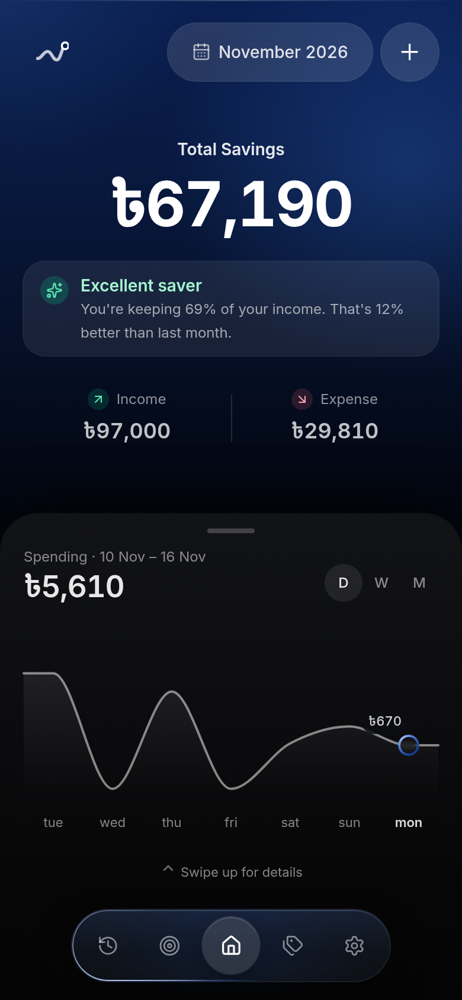
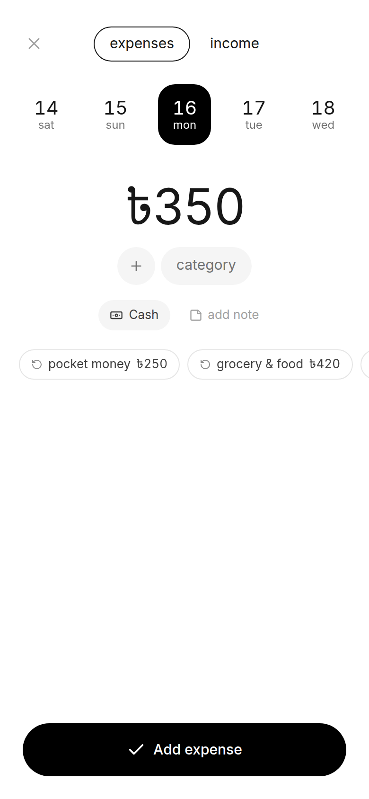
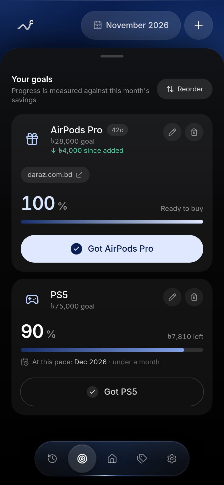
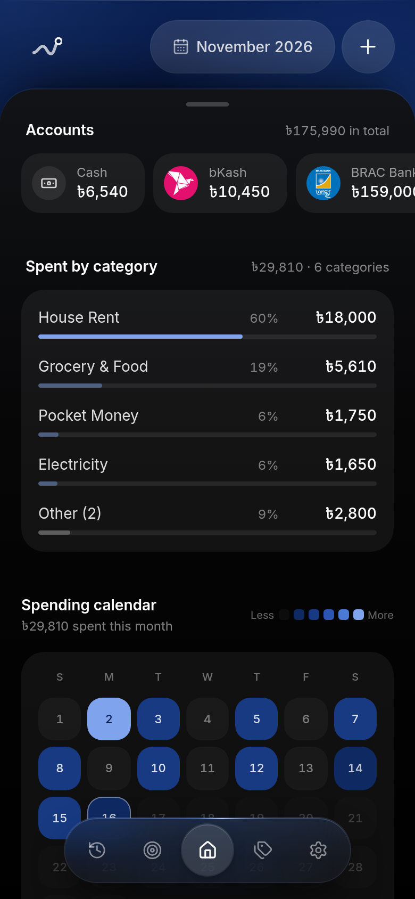
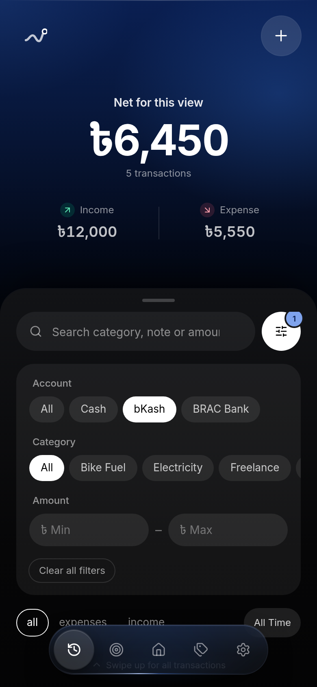
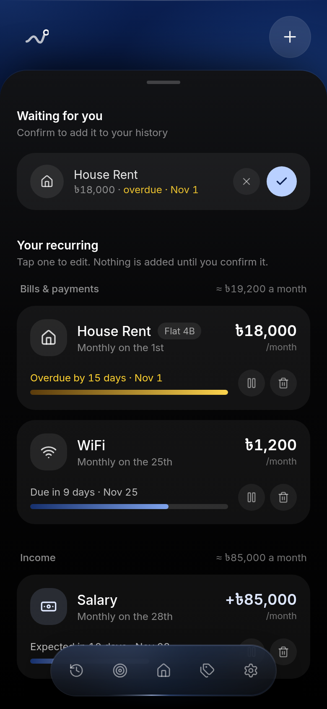
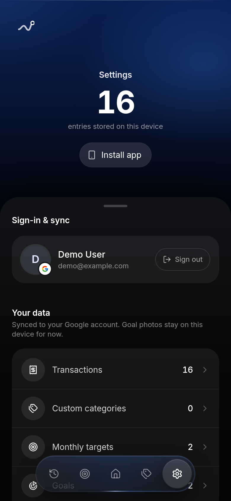
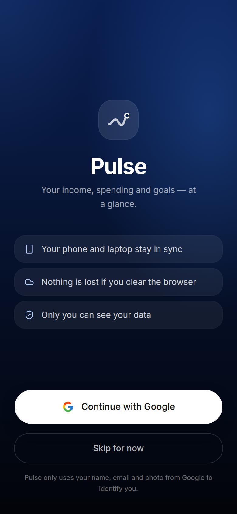

# Pulse — Expense Tracker

Pulse is a personal finance app for your phone. It tracks income and spending across your accounts (Cash, bKash, banks), sets monthly spending limits per category, handles recurring bills and salary, and shows how close your savings are to the things you want to buy.

It's a web app you install on your home screen (PWA). **Sign in with Google** and your data syncs across your devices, and it keeps working **offline**. Or **skip sign-in** and keep everything on the device.

<p align="center">
  
  &nbsp;
  
  &nbsp;
  
</p>

## Features

### Home

<table>
  <tr>
    <td width="260"></td>
    <td>

- **Savings hero**: this month's savings, a short verdict (*Excellent saver*, *On track*, *Overspending*…) and income vs. expense.
- **Spending chart** by day, week or month, compared with the period before.
- **Accounts**: the balance of each account (Cash, bKash, bank…), shown once you have more than one.
- **Spent by category**: one compact list with a share bar per category; small ones fold into "Other".
- **Spending calendar**: each day shaded by how much you spent.
- **Recurring due**, **budget alerts** (categories at 80%+ of their limit) and a **monthly recap** in the first week of each month.
- **Today**: what you've added today; History has the rest.
- A **month picker** to look back at earlier months.

</td>
  </tr>
</table>

### Adding income or expenses

<table>
  <tr>
    <td width="260"></td>
    <td>

- Type the amount with the **phone's own number keyboard**, then pick a category.
- Switch between **expense** and **income**, and backdate with the date strip.
- Optional **note** and **account**.
- **Quick re-add** chips for your recent category + amount pairs.
- The **Add** button stays just above the keyboard.
- A toast when a save pushes a category past **80%** or **100%** of its monthly limit.

</td>
  </tr>
</table>

### History

<table>
  <tr>
    <td width="260"></td>
    <td>

- Every entry, searchable by **category, note or amount** (e.g. "1,200").
- **Filters**: expense/income, date range, account, category and an amount range.
- The totals at the top follow the filters, so it doubles as a *"how much did I spend on X?"* calculator.
- Tap an entry to edit it. Deleting shows an **Undo** toast instead of a confirmation.

</td>
  </tr>
</table>

### Goals

<table>
  <tr>
    <td width="260"></td>
    <td>

Something you're saving up for, like a PS5 or AirPods.

- A **target price**, **icon**, optional **target date**, **photo** and **product links** (cards show just the site name).
- **Progress** against this month's savings: % saved and the amount left.
- **Priority**: drag goals into order, and each shows an **"At this pace"** date.
- **Price changes** are kept, e.g. "↓ ৳4,000 since added".
- **Completing**: bought with savings (recorded as an expense) or a gift. Completed goals open a details sheet and can be reopened.

</td>
  </tr>
</table>

### Recurring

<table>
  <tr>
    <td width="260"></td>
    <td>

- Set up rent, salary, subscriptions or bills once: monthly, weekly or yearly, in **three short steps** (what, how much, when).
- Each occurrence shows up as **due**. Nothing is added until you **confirm** it, and you can change the amount or **skip** it.
- Cards show when the next one is due, with a bar that fills as it gets close, grouped into bills and income with monthly totals.
- Rules can be paused; missed months show as separate overdue items.

</td>
  </tr>
</table>

### Settings and sign-in

<table>
  <tr>
    <td width="260"></td>
    <td width="260"></td>
  </tr>
</table>

- **Sign in with Google** (no passwords), or **Skip for now** to use the app as a guest, with data only on this device. Signing in later uploads what you saved as a guest.
- **Accounts**: Cash plus your own (bKash, Nagad, Rocket, banks, cards) with **real provider logos**, opening balances and live balances. **Transfers** move money between accounts without counting as income or spending.
- **Categories**: built-in plus custom ones (name and icon), show/hide, and **monthly limits** per category.
- **Install app**: a step-by-step guide for iPhone and Android.
- **Reset all data**, and **Delete my account**, which removes your account and everything synced to it.

## Sync and offline

| | Signed in | Guest (skipped sign-in) |
| --- | --- | --- |
| Where data lives | Neon Postgres, tied to your Google account | This browser (`localStorage`) |
| Other devices | Synced | — |
| Offline | Works: changes are queued on the phone and sent when you're back online | Works (nothing to sync) |
| Goal photos | On the device (IndexedDB) for now | On the device (IndexedDB) |

- **Instant**: every change shows immediately and saves in the background. It's only undone if the server rejects it.
- **Offline queue**: changes made with no signal are kept on the phone, even if you close the app, and sent in order when the connection returns. A small cloud icon beside the logo shows how many are waiting.
- **Opens offline**: a service worker caches the app, and your last-loaded data is shown straight away.
- **Undo**: deleting an entry, goal, recurring rule or limit shows **Undo** for a few seconds.

Savings are never stored; they're always calculated from your transactions (income − expenses).

## Tech stack

- [Next.js](https://nextjs.org) 16 (App Router) + React 19 + TypeScript, deployed on Vercel
- Tailwind CSS 4, UI primitives from shadcn / Base UI, Recharts, lucide-react
- [Neon](https://neon.tech) Postgres via [Drizzle ORM](https://orm.drizzle.team); server actions for writes, route handlers for reads
- [Better Auth](https://www.better-auth.com) with Google sign-in
- TanStack Query (optimistic updates, cached data), a custom offline outbox and a service worker
- Installable PWA (web app manifest and generated icons)

> **Note:** this project uses a recent Next.js with breaking changes (e.g. `proxy.ts` instead of `middleware.ts`). Check `node_modules/next/dist/docs/` before relying on older conventions (see `AGENTS.md`).

## Getting started

```bash
npm install
npm run dev      # http://localhost:3000
npm run build    # production build (the service worker only runs here)
npm run start    # serve the production build
npm run lint
```

Without the environment variables below, sign-in is off and the app runs fully in the browser.

### Sign-in and database setup

1. **Neon:** in Vercel, open your project → **Storage** → **Create** → **Neon**. This sets `DATABASE_URL` in Vercel.
2. **Google:** in Google Cloud Console, create an **OAuth client ID** (Web application) with these redirect URIs:
   - `http://localhost:3000/api/auth/callback/google`
   - `https://<your-vercel-domain>/api/auth/callback/google`
3. **Local env:** copy `.env.example` to `.env.local` and fill in `DATABASE_URL`, `BETTER_AUTH_SECRET` (`openssl rand -base64 32`), `BETTER_AUTH_URL`, `GOOGLE_CLIENT_ID` and `GOOGLE_CLIENT_SECRET`. Add the same values in Vercel → **Settings** → **Environment Variables**, with `BETTER_AUTH_URL` set to your production domain.
4. **Tables:** `npm run db:migrate`.

| Script | What it does |
| --- | --- |
| `npm run db:generate` | Writes a new SQL migration to `drizzle/` after you change `src/db/schema.ts` |
| `npm run db:migrate` | Applies pending migrations to the database in `DATABASE_URL` |
| `npm run db:studio` | Opens a browser view of the database |

## Project structure

```
src/
  app/
    (app)/            # Home, history, goals, categories, recurring, settings
    (entry)/          # Full-screen income/expense entry
    sign-in/          # Google sign-in and "Skip for now"
    actions/          # Server actions (writes), one file per data area
    api/              # Better Auth endpoints and data read routes
  components/         # UI by area: dashboard, goals, recurring, accounts, settings, …
  hooks/              # Local (browser) and remote (Neon) data hooks per area
  db/                 # Drizzle schema and Neon client
  server/             # Server-only data access, validation and session checks
  lib/                # Domain logic; offline outbox and queued actions (lib/offline)
  proxy.ts            # Sign-in gate (Next.js 16 "proxy", formerly middleware)
public/sw.js          # Service worker
drizzle/              # SQL migrations
docs/screenshots/     # Images used in this README
```
